# Submission Screenshots

Generated by Playwright specs in `e2e/lab-04/`:
`evidence-screenshots.spec.ts` (views 1-4) and `ticket-detail-screenshots.spec.ts` (views 5-11).
Seeded accounts: IT Staff `staff1@toktickit.com`, Requester `user1@toktickit.com`.

## General views (Zen Green theme, 3 viewports)

| # | Role | View | Viewport | Screenshot | Description |
|---|------|------|----------|------------|-------------|
| 1 | Requester | Dashboard | Desktop 1280 | 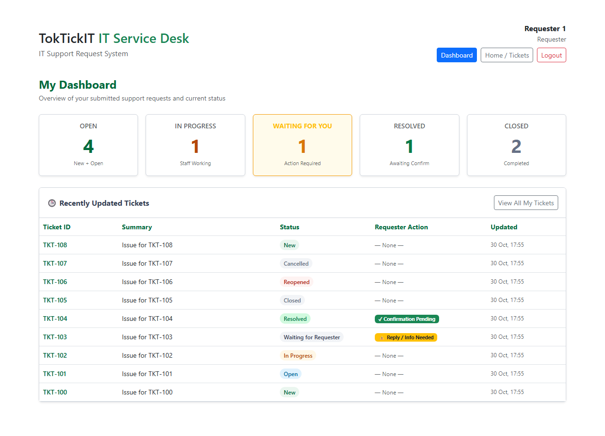 | Zen Green themed dashboard |
| 1b | Requester | Dashboard | Tablet 768 | 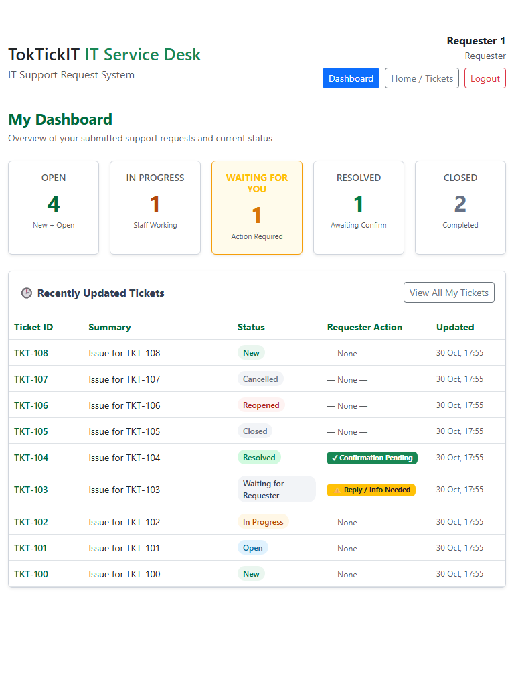 | Zen Green themed dashboard |
| 1c | Requester | Dashboard | Mobile 390 | 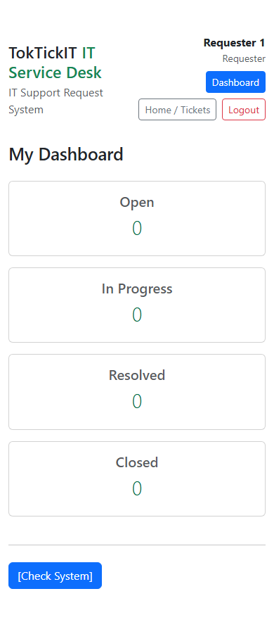 | Zen Green themed dashboard |
| 2 | Requester | Create Ticket | Desktop 1280 | 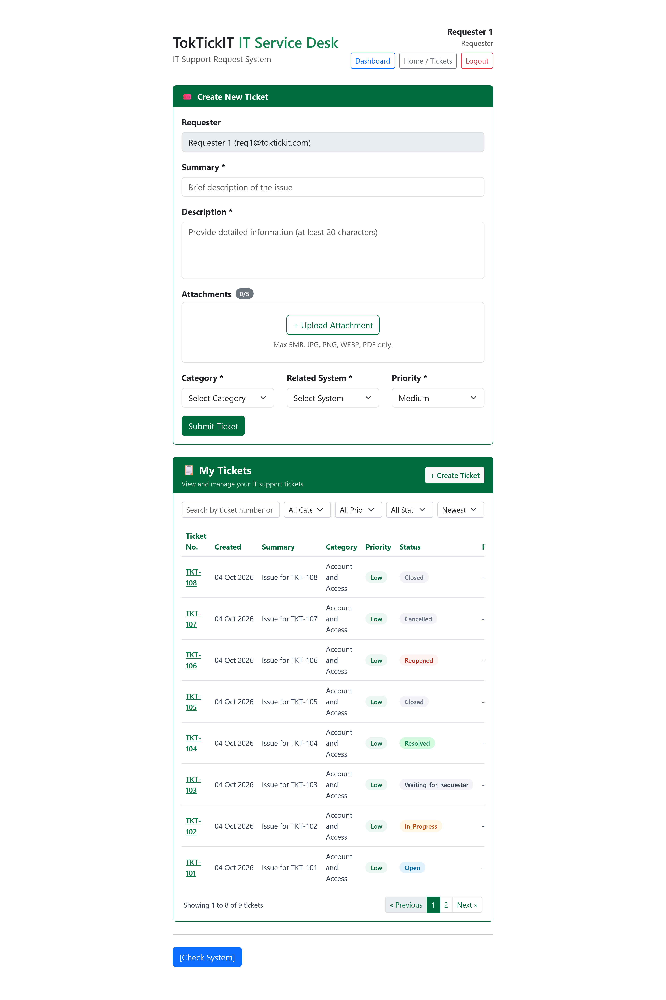 | Themed create ticket form |
| 2b | Requester | Create Ticket | Tablet 768 | 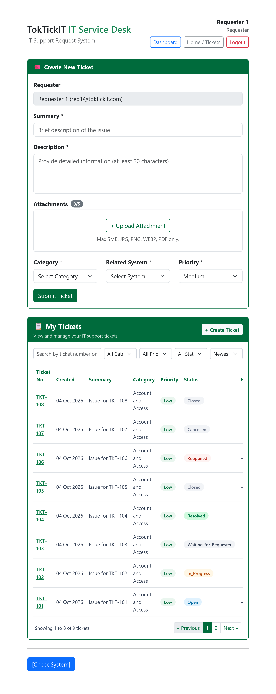 | Themed create ticket form |
| 2c | Requester | Create Ticket | Mobile 390 | 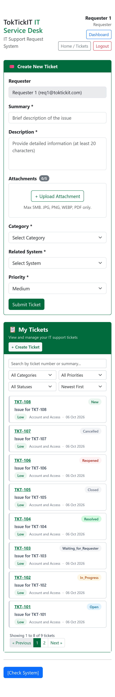 | Themed create ticket form |
| 3 | IT Staff | Dashboard | Desktop 1280 | 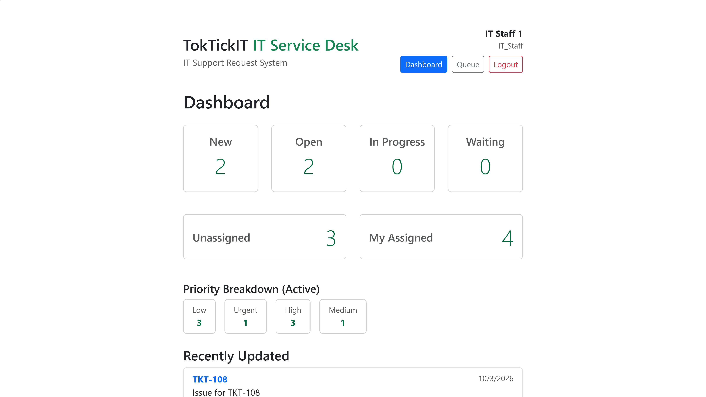 | Zen Green themed dashboard |
| 3b | IT Staff | Dashboard | Tablet 768 | 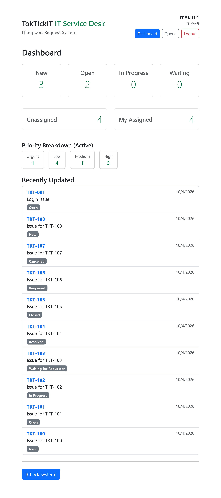 | Zen Green themed dashboard |
| 3c | IT Staff | Dashboard | Mobile 390 | 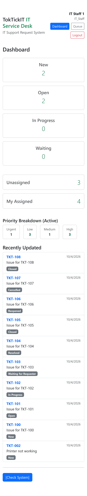 | Zen Green themed dashboard |
| 4 | IT Staff | Ticket Queue | Desktop 1280 | 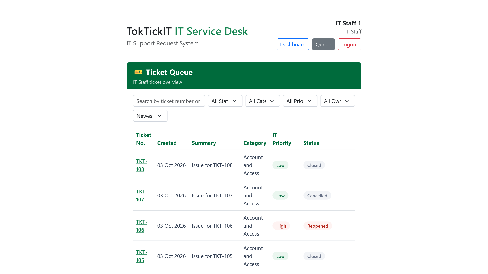 | Themed staff queue |
| 4b | IT Staff | Ticket Queue | Tablet 768 | 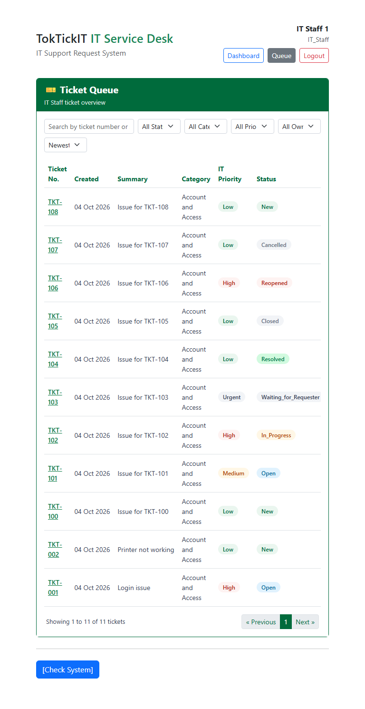 | Themed staff queue |
| 4c | IT Staff | Ticket Queue | Mobile 390 | 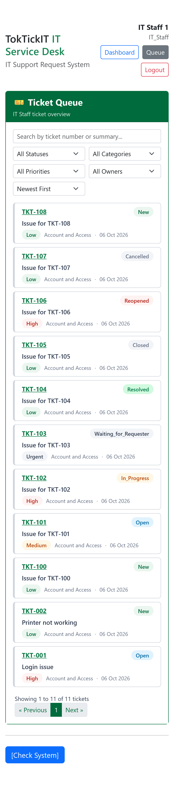 | Themed staff queue |

## Ticket Detail with a visible Action Taken row (Part 6)

Ticket TKT-001. Action: "Reset VPN profile and cleared cached credentials on the laptop" /
"User reconnected to VPN successfully and confirmed access to shared drive".

| # | Role | Viewport | Screenshot | What it shows |
|---|------|----------|------------|---------------|
| 5 | IT Staff | Desktop 1280 | 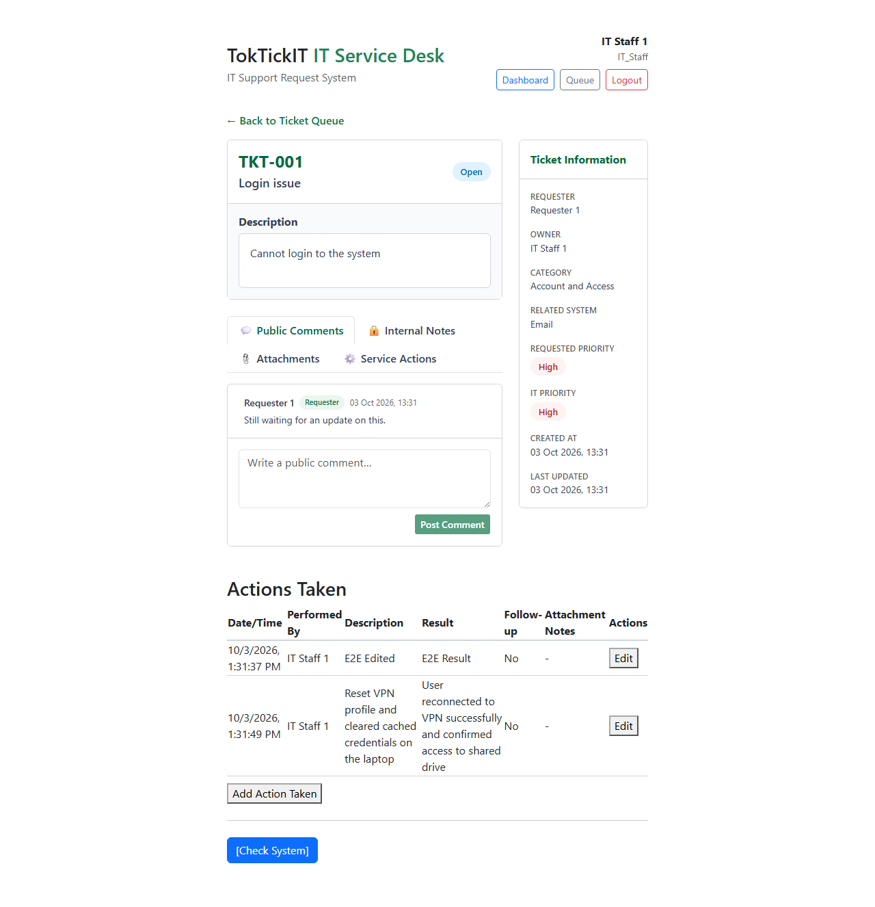 | Full Actions Taken table incl. **Edit** and **Add Action Taken** |
| 6 | IT Staff | Desktop 1280 | 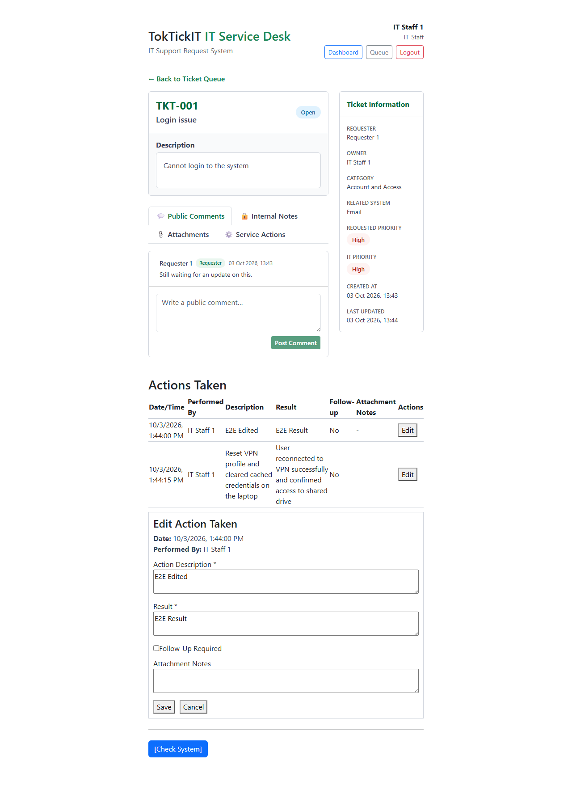 | Edit form open after clicking **Edit** (proves the button works) |
| 7 | IT Staff | Tablet 768 | 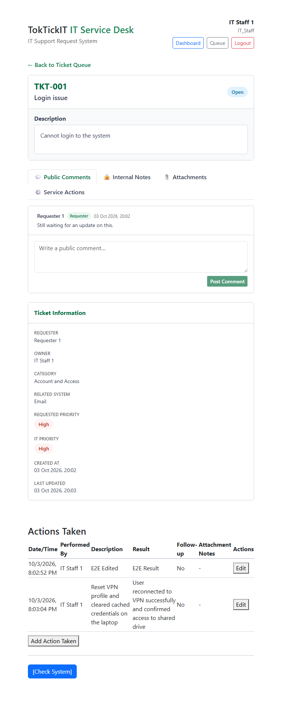 | Full table fits; Edit visible |
| 8 | IT Staff | Mobile 375 | 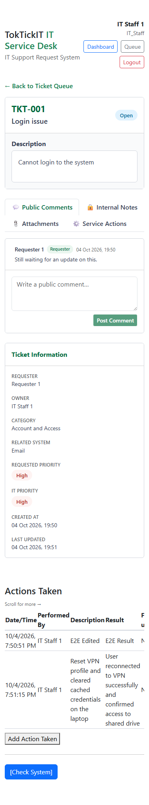 | Table inside horizontal-scroll container (see note) |
| 9 | Requester | Desktop 1280 | 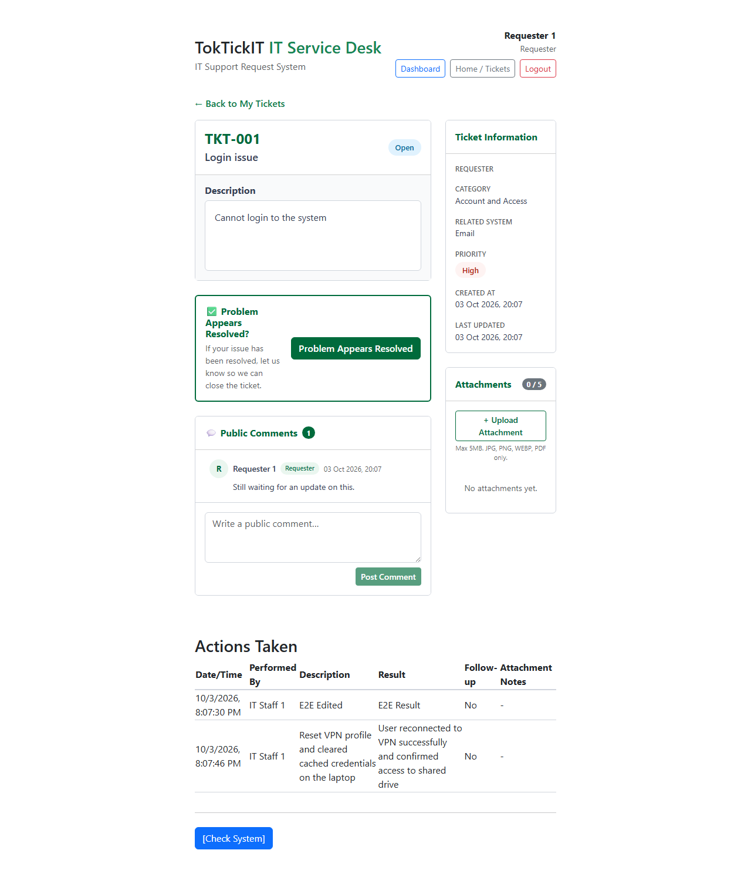 | Read-only: action visible, **no** Edit / Add buttons |
| 10 | Requester | Tablet 768 | 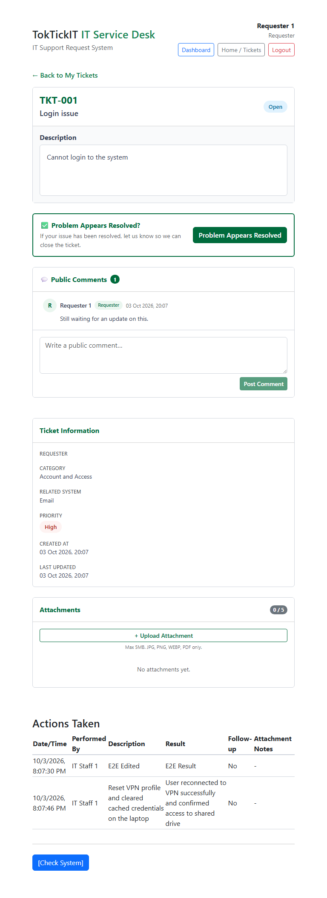 | Read-only, full table fits |
| 11 | Requester | Mobile 375 | 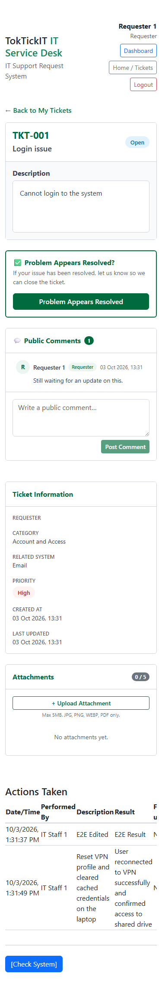 | Read-only, horizontal-scroll container (see note) |

### Layout check (measured by the spec, not just eyeballed)

`<ActionsTaken />` is rendered in its own full-width (`col-12`) row below the main/sidebar columns; the
table itself sits in an `overflow-x: auto` container.

| Viewport | Table container (client / scroll width) | Scrolls horizontally | Overlaps sidebar | Page-level horizontal scroll |
|----------|------------------------------------------|----------------------|------------------|------------------------------|
| Desktop 1280 | 616 / 616 (staff), 616 / 616 (requester) | No | No | No |
| Tablet 768 | 616 / 616 | No | No | No |
| Mobile 375 | 351 / 549 (staff), 351 / 491 (requester) | **Yes** | No | No |

> **Note (mobile):** at 375px the 7-column table needs ~549px (staff) / ~491px (requester), so the
> right-hand columns (Follow-up, Attachment Notes, Actions/Edit) are reached by scrolling the table
> sideways. The page itself does not scroll horizontally and nothing overlaps. A visual scroll hint 
> ("Scroll for more →") is visible on mobile viewports. The Edit button is still clickable on mobile 
> (spec clicks it at every viewport).
> The app container is capped at `maxWidth: 640` in `App.tsx`, which is why the table cannot widen on desktop.

## Accessibility & Design Consistency Checklist

| Check | Screens It Applies To | Result | Evidence |
|-------|----------------------|---------|----------|
| Keyboard: every interactive control reachable via Tab | All forms & dashboards | Pass | Verified by `ui-style-a11y.spec.ts` Tab traversal test |
| Visible focus indicator present on focused element | All interactive elements | Pass | Default Bootstrap focus rings verified by Playwright |
| Modal/dialog focus trap + Escape-to-close | N/A | N/A | No modals are used in this UI |
| Form fields have real associated labels | Create Ticket, Add Action | Pass | Fixed missing `htmlFor` in `CreateTicket.tsx` and `StaffTicketQueue.tsx`; Verified by `axe-core/playwright` (`ui-style-a11y.spec.ts`) |
| Validation errors are associated and announced | Form error banners | Pass | Fixed missing `role="alert"` in `CreateTicket.tsx` and Detail pages; Verified by `ui-style-a11y.spec.ts` |
| Status/priority/private vs shared don't rely on color alone | Dashboards, Queues, Ticket Details | Pass | Status and Priority badges include explicit text (verified visually & via Axe) |
| No horizontal page-level scroll at any viewport | All major screens | Pass | Verified by `ui-style-a11y.spec.ts` (`pageHasHorizontalScroll: false`) |
| No clipped/overlapping content at any viewport | All major screens | Pass | Verified by `ticket-detail-screenshots.spec.ts` (`overlapsSidebar: false`) |
| Zen Green design consistency (badges/cards) | All screens | Pass | Verified visually across all generated screenshots |
| Active-page navigation indication present | Main navigation bar | Pass | Active state visually highlighted on selected Nav links |

> **Exception:** The `ActionsTaken` table intentionally uses horizontal scrolling on mobile viewports to prevent layout breakage. This is explicitly verified by the layout checks above and includes a visual affordance.
